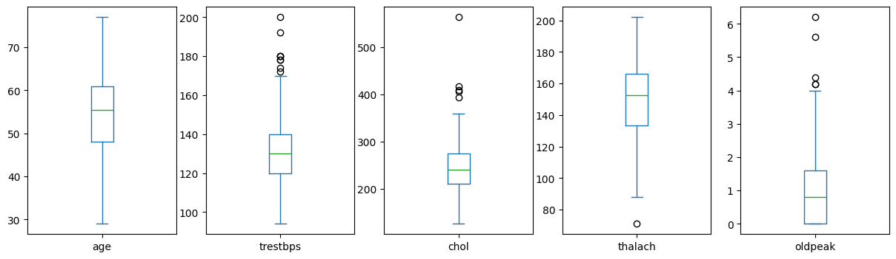
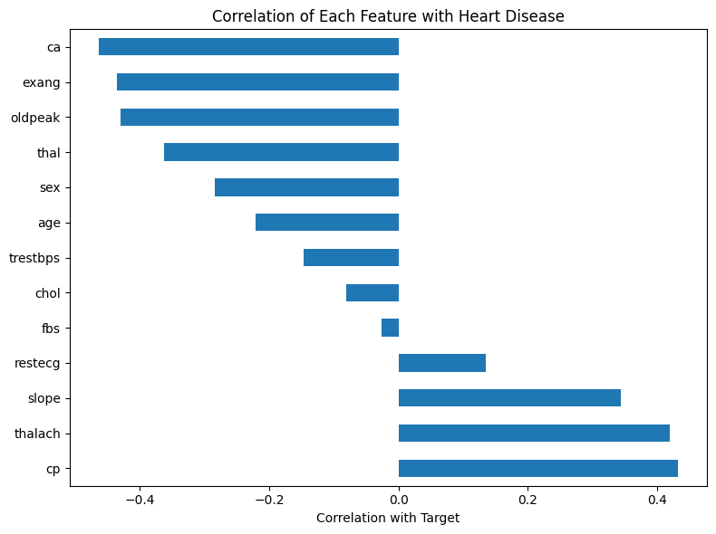
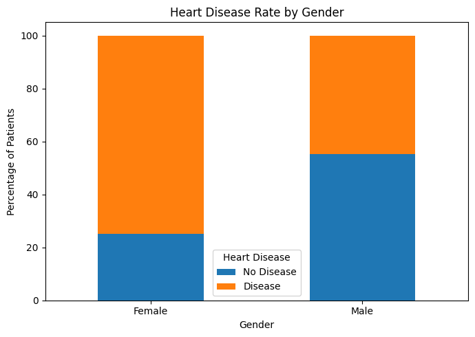
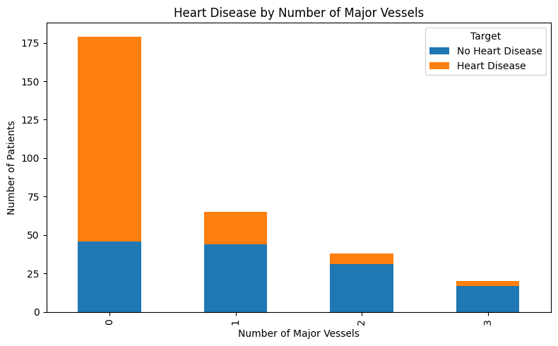
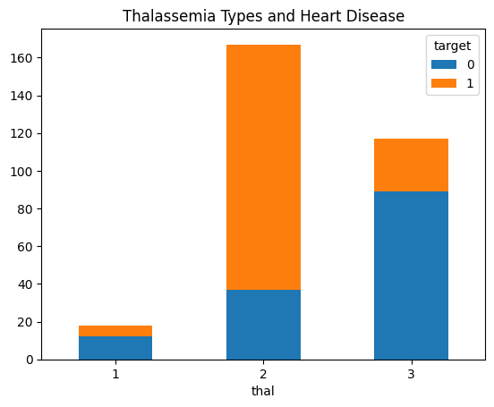
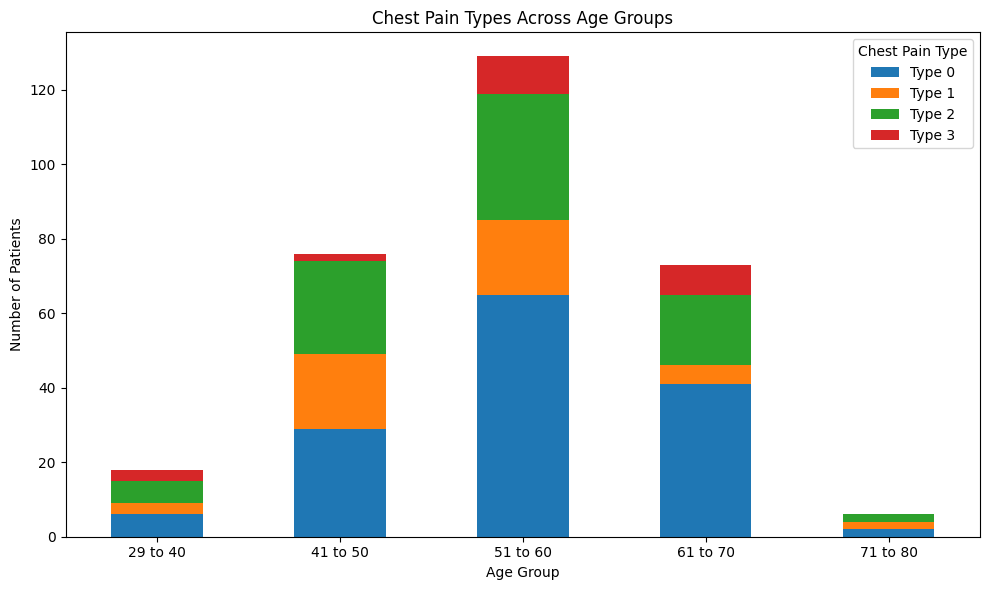
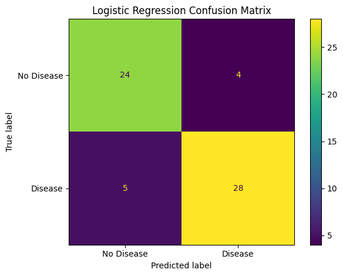
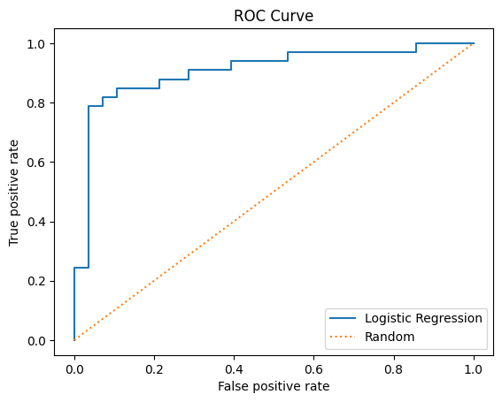

# Heart Disease Analysis

This project looks at a heart disease dataset to find out which factors are linked to heart disease and what a high risk patient looks like. It covers data cleaning, exploratory analysis, visualizations, a few statistical tests and a logistic regression model.

The work was done as part of a data analytics project at Jobaaj, based on a case study where I play the role of a data analyst at a healthcare company called HealthPulse Analytics.

## Dataset

The data comes from the [Kaggle Heart Disease Dataset](https://www.kaggle.com/datasets/johnsmith88/heart-disease-dataset). It has 1025 rows and 14 columns covering patient age, sex, chest pain type, blood pressure, cholesterol, blood sugar, ECG results, maximum heart rate, exercise induced angina, oldpeak, slope, number of major vessels, thalassemia and the target (heart disease or not).

## Tools Used

Python, Pandas, NumPy, Matplotlib, Seaborn, SciPy and Scikit learn

## Data Cleaning

* Found 723 exact duplicate rows. After removing them, 302 unique patients were left.
* ca = 4 and thal = 0 are not valid according to the data dictionary, so they were treated as missing values and filled with the most common value.
* Numerical columns were kept as numbers and categorical columns were changed to the category type.
* Outliers were checked with the IQR method and boxplots. 20 were found, but they look like real patient readings, so they were kept.
* The clinical measurements were normalized with StandardScaler and saved in a separate copy.



## What the Analysis Covers

The notebook answers 25 questions split into three levels.

**Basic:** average age, gender split, blood pressure, cholesterol, blood sugar, chest pain types, heart rate and number of major vessels.

**Medium:** age and cholesterol correlation, chest pain by age group, heart rate and angina, a t test on blood pressure by gender, and how blood sugar, major vessels, thalassemia and common risk factor combinations relate to heart disease.

**Advanced:** combined effect of age, cholesterol and blood pressure, correlation of every feature with heart disease, a logistic regression model, slope by chest pain type and thalassemia by age.

## Key Findings

* The factors most strongly linked to heart disease were the number of major vessels, chest pain type, exercise induced angina, oldpeak, maximum heart rate, thalassemia type and sex.
* Cholesterol, resting blood pressure and fasting blood sugar showed only weak relationships with heart disease.
* 75% of female patients had heart disease compared with 44.66% of male patients, even though males made up 68% of the dataset.
* The most common profile among heart disease patients was a fixed defect (thal 2) with no exercise induced angina.
* There was no significant difference in resting blood pressure between males and females (p = 0.34).











## Model Results

A logistic regression model was trained on all features with an 80/20 train and test split.

| Metric | Score |
|---|---|
| Accuracy | 85.2% |
| Precision | 87.5% |
| Recall | 84.8% |
| ROC AUC | 0.906 |

It correctly identified 28 of the 33 heart disease cases in the test set.





## A Note on the Data

Some results go against what you would expect medically. For example, patients with fewer blocked vessels and a higher maximum heart rate show more heart disease. This is a known issue with this version of the dataset, where the target labels may be reversed compared with the original data. The analysis follows the data dictionary as given (1 = heart disease), so these results should be read with care.

The dataset also has no follow up information, so survival rates could not be properly studied.

## How to Run

1. Clone this repository.
2. Install the libraries:
   ```
   pip install pandas numpy matplotlib seaborn scipy scikit-learn
   ```
3. Open the notebook in Jupyter and update the file path to where heart.csv is saved.
4. Run all cells from top to bottom.

## Files

* `heart.csv` : the dataset
* `.ipynb` notebook : the full analysis with code, charts and insights
* `EDA03 - Heart Health Analysis.docx` : the original case study and questions
* `images` : charts used in this README
